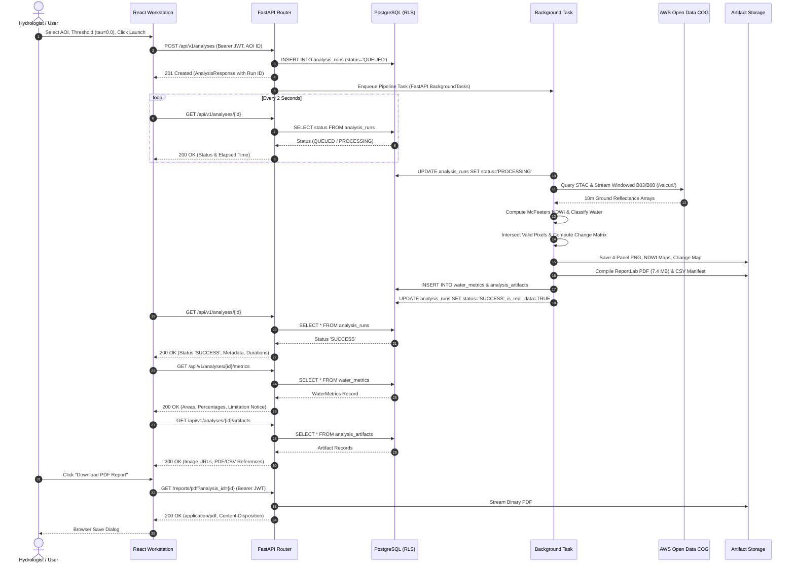
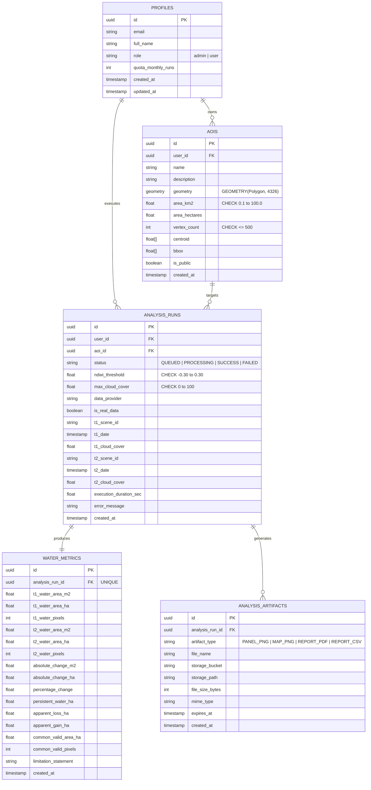

# DharaScope — System Architecture & Component Interactions
## Comprehensive Architectural Blueprint for the Satellite-Based Surface Water Dynamics Platform

**Project:** DharaScope  
**Document Version:** 2.5.0  
**Status:** Approved Academic Architecture Baseline  
**Target Environment:** Local Workstation / Cloud-Ready Containerized Stack  

---

## 1. System Overview & Architectural Topology

DharaScope is structured as a decoupled, multi-tier enterprise geospatial information system (GIS). It bridges raw optical earth observation data from the European Space Agency (ESA) Copernicus Sentinel-2 constellation down to a high-performance modern web GIS workstation.

The platform comprises five primary operational tiers:
1. **Presentation Tier (React 19 GIS Workstation):** Single-page application built on React 19, TypeScript, Vite, and Leaflet. Features cartographic visualization, interactive AOI digitizing, real-time status telemetry, and publication exports.
2. **API & Service Tier (FastAPI ASGI Application):** Asynchronous Python application server providing OpenAPI-compliant REST endpoints, dependency-injected authentication, request validation, and asynchronous pipeline worker dispatch.
3. **Data & Spatial Persistence Tier (PostgreSQL 16 + PostGIS 3.6):** Relational database enforcing spatial integrity, GiST topological indexing, Row-Level Security (RLS) policies, and foreign key cascading.
4. **Earth Observation Ingestion & Processing Core:** Modular Python scientific engine implementing STAC discovery, windowed `/vsicurl/` Cloud-Optimized GeoTIFF (COG) streaming, McFeeters NDWI spectral indexing, and 4-class categorical transition change detection.
5. **Security & Identity Tier (Supabase Auth + Database Session Propagation):** Dual-layer authentication combining cryptographic JWT validation (HS256/RS256) with transaction-local PostgreSQL session identity propagation.

```mermaid
flowchart TD
    subgraph ClientTier["Presentation Tier (Client Browser)"]
        UI["React 19 + TypeScript GIS Workstation"]
        Leaflet["Leaflet Cartographic Canvas (Dark Matter)"]
        AuthCtx["Supabase Auth Context & JWT Bearer"]
    end

    subgraph ServiceTier["API & Application Service Layer (FastAPI :8000)"]
        RouterAuth["/api/v1/auth & /api/v1/admin"]
        RouterAOI["/api/v1/aois (Validate & CRUD)"]
        RouterAnalysis["/api/v1/analyses (Dispatch & Polling)"]
        RouterReports["/reports (PDF & CSV Streaming)"]
        Worker["In-Process Background Pipeline Worker"]
    end

    subgraph DatabaseTier["Spatial Persistence Tier (PostgreSQL 16 + PostGIS 3.6)"]
        RLS["PostgreSQL Row-Level Security (dharascope_app)"]
        TableProfiles["profiles (UUID, Role, Quota)"]
        TableAOIs["aois (GEOMETRY Polygon 4326, GiST)"]
        TableRuns["analysis_runs (Lifecycle Status, Timestamps)"]
        TableMetrics["water_metrics (KPIs, Ha, % Change)"]
        TableArtifacts["analysis_artifacts (Storage References)"]
    end

    subgraph ScienceTier["Satellite Processing Core"]
        STAC["CDSE / Earth Search STAC Client"]
        Downloader["Windowed COG Streamer (/vsicurl/)"]
        Spectral["McFeeters NDWI Engine (B03/B08)"]
        Change["4-Class Categorical Transition Matrix"]
        Carto["Publication Cartography (300 DPI)"]
        Reporter["ReportLab PDF & CSV Generator"]
    end

    subgraph ExternalServices["External Satellite & Cloud Infrastructure"]
        CDSE["Copernicus Data Space Ecosystem (ESA)"]
        AWS["AWS Open Data Sentinel-2 COG Archive"]
        SupabaseIdP["Supabase Auth Identity Provider"]
    end

    UI -->|HTTPS / Bearer JWT| ServiceTier
    Leaflet -->|Interactive Bounds| RouterAOI
    AuthCtx -->|Session Validation| RouterAuth
    AuthCtx -.->|OAuth2 / Password| SupabaseIdP

    RouterAuth --> RLS
    RouterAOI --> RLS
    RouterAnalysis --> RLS
    RouterAnalysis -->|Dispatch Task| Worker

    Worker --> STAC
    Worker --> Downloader
    Downloader -->|Byte-Range Reads| AWS
    Downloader -->|OData Keycloak| CDSE
    Downloader --> Spectral
    Spectral --> Change
    Change --> Carto
    Change --> Reporter
    Worker -->|Persist Metrics & Artifacts| RLS

    RLS --> TableProfiles
    RLS --> TableAOIs
    RLS --> TableRuns
    RLS --> TableMetrics
    RLS --> TableArtifacts
```



---

## 2. Component Interactions & Request Lifecycles

### 2.1 AOI Validation & Creation Lifecycle
1. The user draws or selects a pre-configured polygon on the Leaflet map.
2. The client transmits GeoJSON to `POST /api/v1/aois/validate`.
3. The backend executes `validate_aoi_polygon()`:
   - Validates coordinate bounds $[-180, 180]$ longitude and $[-90, 90]$ latitude.
   - Evaluates topological validity via Shapely (`geom.is_valid`).
   - Counts vertices, enforcing $\le 500$ vertices.
   - Projects coordinates to WGS84 ellipsoid via `pyproj.Geod` and calculates geodetic surface area.
   - Enforces $0.10\text{ km}^2 \le \text{Area} \le 100.00\text{ km}^2$.
4. Upon confirmation, `POST /api/v1/aois` persists the validated polygon to PostGIS with ownership metadata (`user_id`).

### 2.2 Asynchronous Satellite Analysis Lifecycle



---

## 3. Database Schema & Spatiotemporal Design

The database schema is managed via SQLAlchemy 2.0 and Alembic. PostGIS extensions provide geometric storage and spatial calculations in native WGS84 (`EPSG:4326`).



---

## 4. Security Architecture & Defense-in-Depth

DharaScope implements four concentric security boundaries:

1. **Network & CORS Perimeter:** Starlette `CORSMiddleware` strictly whitelists trusted development origins (`http://localhost:5173`, `http://127.0.0.1:5173`, `http://localhost:8000`, `http://127.0.0.1:8000`) for credentialed requests, rejecting wildcard origins when cookies or Authorization headers are present.
2. **Cryptographic Identity Validation:** Outbound requests carry `Authorization: Bearer <JWT>`. Backend validation in `src/auth.py` verifies tokens using either symmetric HS256 secret verification or asymmetric RS256/ES256 JWKS keys fetched from Supabase's `.well-known/jwks.json`. Client-side token creation is strictly isolated to development environments (`import.meta.env.DEV`), and production backends reject development tokens with HTTP 401.
3. **Transactional PostgreSQL Identity Propagation:** Before servicing any business query, the database dependency executes:
   ```sql
   SET LOCAL ROLE dharascope_app;
   SELECT set_config('request.jwt.claim.sub', :user_id, true);
   ```
   This switches PostgreSQL from the superuser/schema owner to the unprivileged application role, binding the request's UUID to transaction-local configuration.
4. **PostgreSQL Row-Level Security (RLS):** Enabled and forced across all five tables via migration `5903f15a19ed_enable_rls_and_policies.py`. 20 granular SQL policies ensure:
   - Users can only view and mutate their own profile, private AOIs, and analysis runs.
   - Child metrics and artifacts inherit the tenant isolation of their parent run.
   - Cross-user data leaks are prevented directly by the database kernel even if an application route bug occurs.

---

## 5. Storage Subsystem & Retention Policy

Generated rasters, maps, CSV manifests, and PDF reports are decoupled from the relational database:
- **Zero Binary Storage in Database:** The database stores strictly typed metadata (`file_name`, `storage_path`, `storage_bucket`, `mime_type`, `file_size_bytes`).
- **Storage Provider Abstraction (`src/storage.py`):**
  - *Local File System Provider:* Organizes artifacts under `outputs/{analysis_id}/` for local development.
  - *Supabase Storage Provider:* Uploads artifacts to partitioned cloud buckets (`dharascope-reports`, `dharascope-maps`, `dharascope-rasters`) using authenticated API requests.
- **Retention Metadata:** Artifacts record an `expires_at` timestamp (default 90 days) supporting automated lifecycle cleanup policies.
