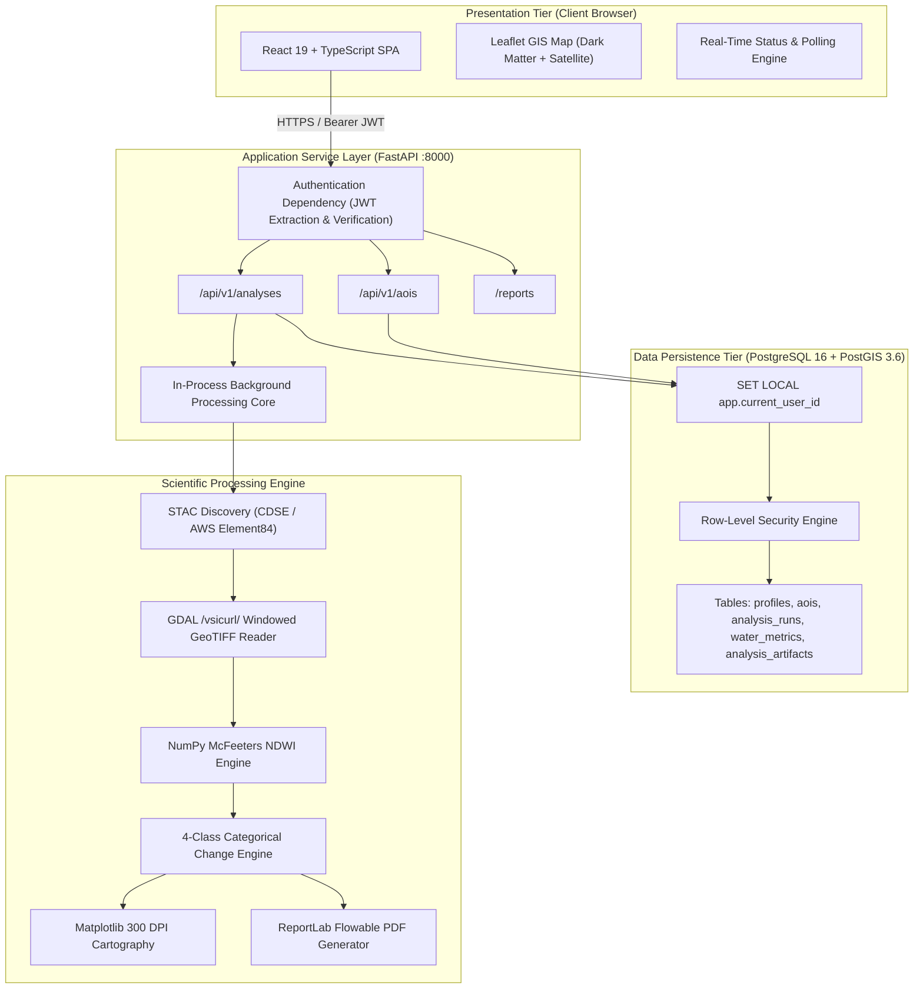
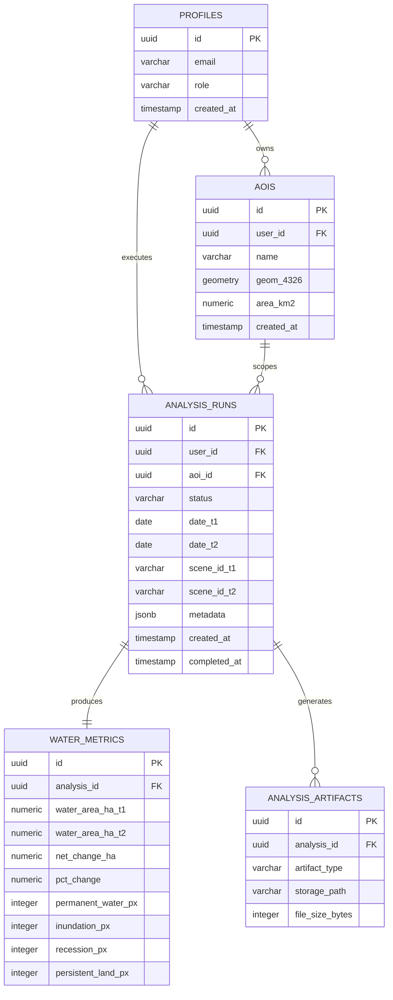

# DharaScope: Automated Satellite-Based Surface Water Dynamics Monitoring Platform
## Final Academic Capstone Project Report

**Author:** DharaScope Engineering & Science Team  
**Date:** November 2026  
**Document Version:** 1.0.0 (Phase 2.5 Baseline)  
**Repository:** `https://github.com/dhara-scope/dharascope`  
**License:** MIT License  

---

## Executive Summary

Surface water bodies in rapidly urbanizing and agricultural river basins experience acute spatiotemporal fluctuations driven by seasonal monsoon dynamics, municipal discharge, drainage, and water control infrastructure. Traditional hydrologic surveying relies on sparse in-situ gauging stations that lack spatial continuity and cannot capture distributed floodplain inundation or channel morphology shifts. Satellite Earth Observation (EO) provides repetitive, synoptic coverage; however, operationalizing EO pipelines requires overcoming barriers in data volume, complex atmospheric/radiometric corrections, multi-tenant cloud security, spatial query performance, and reproducible cartographic reporting.

**DharaScope** is an end-to-end, open-source geospatial platform designed for automated, reproducible surface water detection and temporal change analysis. Built on the European Space Agency's (ESA) Copernicus Sentinel-2 constellation, DharaScope provides:
1. Spatial indexing and multi-temporal bounding box querying using PostGIS 3.6 and SpatioTemporal Asset Catalog (STAC) protocols.
2. Windowed raster streaming via GDAL Virtual File Systems (`/vsicurl/`) and Cloud-Optimized GeoTIFFs (COGs), eliminating full-granule ingestion bottlenecks.
3. Scientifically rigorous water extraction using McFeeters Normalized Difference Water Index (NDWI) at 10-meter spatial resolution.
4. Categorical 4-class change detection (Permanent Water, Water Inundation, Water Recession, Persistent Land) with transition matrix verification.
5. Production-grade multi-tenant security featuring PostgreSQL Row-Level Security (RLS) and Supabase JWT authentication.
6. Automated generation of publication-quality cartographic figures and comprehensive PDF/CSV analytical reports.

This report documents the architectural design, remote sensing methodology, software engineering principles, empirical validation on the Gomti River basin (Lucknow, India), multi-scale hydro-spatial dynamics, limitations, and future trajectories of the platform.

---

## 1. Introduction & Problem Statement

### 1.1 The Surface Water Monitoring Challenge
Freshwater availability and hydrological extremes (flooding and seasonal desiccation) represent major environmental challenges in South Asia. In peninsular and northern India, rivers such as the Gomti (a key tributary of the Ganga) support tens of millions of people, intensive agriculture, and dense urban centers. The Gomti River basin exhibits high hydrological variability: peak discharge during the southwest monsoon (July–September) gives way to severe post-monsoon and pre-monsoon baseflow recessions.

Traditional hydrological monitoring faces critical limitations:
- **Spatial Sparsity:** In-situ river gauges are separated by tens or hundreds of kilometers, leaving vast river reaches and agricultural floodplains unmonitored.
- **Data Latency & Inaccessibility:** Gauging data is often proprietary, manually logged, or published with significant latency.
- **Resource Intensity:** Field surveys of dynamic wetlands and riparian buffer zones are logistically prohibitive at regional scales.

### 1.2 Satellite Remote Sensing Opportunities & Engineering Hurdles
Modern multispectral satellite constellations—specifically Copernicus Sentinel-2 (Twin satellites S2A and S2B)—acquire multispectral imagery globally every 5 days at 10-meter to 20-meter spatial resolution. While data is freely accessible via the Copernicus Data Space Ecosystem (CDSE) and AWS Open Data registries, deploying an operational web GIS faces substantial engineering challenges:
1. **Data Ingestion Bottlenecks:** A single Sentinel-2 Level-2A granule spans $\sim 500\text{ MB}$ to $1\text{ GB}$. Downloading entire granules across multiple timestamps to analyze a localized $5\text{ km}^2$ reach incurs prohibitive bandwidth and compute costs.
2. **Multi-Tenant Spatial Isolation:** Multi-user platforms require strict data segregation. Analytical results, user-digitized Areas of Interest (AOIs), and downloadable reports must be protected against cross-tenant leakage.
3. **Reproducibility & Scientific Integrity:** Automated water masking requires transparent, auditable algorithms with explicit handling of cloud cover, NoData voids, and projection distortions.
4. **Scale Dependency:** Remote sensing metrics vary fundamentally across spatial scales. Misinterpreting reach-scale impoundments versus regional floodplain desiccation leads to erroneous scientific and policy conclusions.

### 1.3 Project Objectives & Success Criteria
DharaScope was developed to deliver an open, reproducible, and production-grade solution. The project established seven strict functional objectives:
1. **Interactive Cartographic Digitization:** Enable users to define and validate arbitrary polygon AOIs up to $100\text{ km}^2$ with topological validation.
2. **STAC-Compliant Satellite Discovery:** Query live Copernicus Sentinel-2 catalogs for cloud-filtered dual-temporal acquisitions ($T_1$ and $T_2$).
3. **Windowed Sub-Granule Processing:** Stream only the necessary spectral bands (B03 Green, B08 NIR) intersecting the AOI bounding box using HTTP range GET requests.
4. **Validated Water Classification:** Compute McFeeters NDWI and apply a calibrated zero threshold ($\text{NDWI} > 0.0$) with valid-data masking.
5. **Categorical Change Detection:** Quantify 4-class transition matrices and compute net water gain/loss in hectares and percentage change.
6. **Enterprise Multi-Tenant Security:** Enforce Supabase Auth token verification, PostgreSQL Row-Level Security, and restricted database role sessions.
7. **Automated Publication Reporting:** Generate self-contained PDF reports (with 300 DPI cartographic figures) and machine-readable CSV datasets.

---

## 2. Literature Review & Remote Sensing Fundamentals

### 2.1 Optical Water Indices
Optical remote sensing of surface water exploits the distinctive spectral reflectance curve of clear liquid water compared to terrestrial surfaces (soil, vegetation, man-made structures).

```
Wavelength Range:
- Blue (490 nm) & Green (560 nm): Moderate reflectance (10–15%)
- Red (665 nm): Low reflectance (<5%)
- Near-Infrared (NIR, 842 nm): Near-total absorption (~0%)
- Shortwave Infrared (SWIR, 1610–2190 nm): Complete absorption (~0%)
```

In contrast, green vegetation exhibits strong chlorophyll absorption in the red and high scattering in the NIR ("red edge" and NIR plateau, reflectance 40–60%). Bare soil exhibits monotonically increasing reflectance from visible to SWIR wavelengths.

#### McFeeters Normalized Difference Water Index (NDWI)
Formulated by S. K. McFeeters in 1996, NDWI enhances water body reflectance in the green band while suppressing the high reflectance of terrestrial vegetation and soil in the NIR:

$$\text{NDWI} = \frac{\rho_{\text{Green}} - \rho_{\text{NIR}}}{\rho_{\text{Green}} + \rho_{\text{NIR}}}$$

In the Sentinel-2 MultiSpectral Instrument (MSI) sensor:
- $\rho_{\text{Green}} = \text{Band 3}$ (center wavelength $560\text{ nm}$, $10\text{ m}$ GSD).
- $\rho_{\text{NIR}} = \text{Band 8}$ (center wavelength $842\text{ nm}$, $10\text{ m}$ GSD).

Because both Band 3 and Band 8 operate natively at 10-meter ground sampling distance (GSD), McFeeters NDWI preserves full spatial resolution without requiring spatial resampling or pan-sharpening (unlike Xu's Modified NDWI / MNDWI, which requires Band 11 SWIR at 20-meter resolution).

#### Theoretical Thresholding & Index Boundaries
- **$\text{NDWI} > 0.0$:** Classified as **Water**. Pure water pixels typically exhibit NDWI values between $+0.15$ and $+0.80$.
- **$\text{NDWI} \le 0.0$:** Classified as **Non-Water**. Green canopy vegetation typically yields NDWI values between $-0.40$ and $-0.80$; bare soil and urban infrastructure yield values between $-0.30$ and $-0.05$.

### 2.2 Sentinel-2 Sensor Characteristics
The Copernicus Sentinel-2 mission comprises two identical polar-orbiting satellites in a sun-synchronous orbit at an altitude of $786\text{ km}$ with an orbital inclination of $98.62^\circ$.

| Spectral Band | Band Center ($\text{nm}$) | Bandwidth ($\text{nm}$) | Spatial Resolution ($\text{m}$) | Radiometric Purpose |
| :--- | :--- | :--- | :--- | :--- |
| **B01** | 443 | 20 | 60 | Coastal aerosol & atmospheric correction |
| **B02** | 490 | 65 | 10 | Blue: soil/vegetation discrimination |
| **B03** | 560 | 35 | 10 | **Green: water discrimination & NDWI numerator** |
| **B04** | 665 | 30 | 10 | Red: chlorophyll absorption |
| **B05–B07** | 705–783 | 15–20 | 20 | Red Edge: vegetation status |
| **B08** | 842 | 115 | 10 | **NIR: water absorption & NDWI denominator** |
| **B8A** | 865 | 20 | 20 | Narrow NIR: water vapor correction |
| **B09** | 945 | 20 | 60 | Water vapor absorption |
| **B11–B12** | 1610–2190 | 90–180 | 20 | SWIR: moisture, snow/ice, geology |

Sentinel-2 Level-2A (L2A) products deliver Bottom-Of-Atmosphere (BOA) surface reflectance derived via the Sen2Cor processor, correcting for Rayleigh scattering, aerosol absorption, and cirrus clouds.

---

## 3. System Architecture & Engineering Design

### 3.1 Architectural Topology
DharaScope follows a modular, decoupled micro-architecture comprising a modern Single-Page Application (SPA) frontend, an asynchronous Python backend, and an enterprise spatial relational database.



### 3.2 Spatial Relational Schema (PostGIS 3.6)
The relational persistence layer enforces strict topological validity, foreign-key cascades, and audit timestamps.



#### Spatial Integrity Enforcement
The `aois` table enforces geometry integrity via PostGIS check constraints:
- `ST_IsValid(geom)`: Guarantees simple, non-self-intersecting polygons.
- `ST_GeometryType(geom) IN ('ST_Polygon', 'ST_MultiPolygon')`: Rejects non-areal geometries (points, linestrings).
- `ST_Area(geom::geography) / 1000000.0 <= 100.0`: Enforces the operational compute bound of $100\text{ km}^2$.
- GiST spatial index `idx_aois_geom`: Accelerates bounding-box spatial queries and intersection filters.

### 3.3 Security Architecture: Row-Level Security & Admin Role Sync
DharaScope implements defense-in-depth isolation across the application and database tiers:

1. **Authentication:** Clients authenticate with Supabase Auth (or the local development provider) and receive signed JWTs containing user claims (`sub`, `aud`, `email`, `role`).
2. **Session Context Propagation:** Every FastAPI request dependency validates the bearer token, establishes a dedicated SQLAlchemy session using the restricted `dharascope_app` PostgreSQL role, and executes:
   ```sql
   SET LOCAL app.current_user_id = '<user-uuid>';
   ```
3. **Database RLS Policies:** PostgreSQL policies on all analytical tables enforce tenancy at the database engine level:
   ```sql
   CREATE POLICY user_isolation_policy ON aois
       FOR ALL
       USING (user_id = NULLIF(current_setting('app.current_user_id', true), '')::uuid);
   ```
   Even if an application vulnerability omitted a `WHERE user_id = ...` filter, PostgreSQL returns zero records for foreign tenant rows.
4. **Authoritative Admin Role Check:** Privileged admin operations verify the user's role against the database `profiles` table rather than relying solely on client-provided JWT claims. If an admin is revoked in the database, subsequent requests immediately fail with `403 Forbidden`, regardless of token expiry.
5. **Role Synchronization Journal:** Changes to user roles across Supabase Auth and PostgreSQL are executed via an idempotent distributed transaction with compensating updates and local audit journaling (`outputs/metadata/role_sync_audit.jsonl`).

---

## 4. Earth Observation Processing Engine

### 4.1 Windowed Cloud-Optimized GeoTIFF Streaming
To avoid downloading multi-hundred-megabyte Sentinel-2 granules, DharaScope leverages the Cloud-Optimized GeoTIFF (COG) specification. COGs organize pixel data into regular spatial tiles (typically $256 \times 256$ or $512 \times 512$ pixels) and include internal pyramid overviews.

```
+-----------------------------------------------------------+
| Sentinel-2 L2A Granule (~10,980 x 10,980 pixels, ~500 MB) |
|                                                           |
|             +-------------+                               |
|             | AOI Window  |  <-- HTTP GET Range Request   |
|             | (222 x 199) |      Transfers ONLY ~88 KB    |
|             +-------------+                               |
|                                                           |
+-----------------------------------------------------------+
```

Using GDAL's `/vsicurl/` virtual filesystem driver wrapped in `rasterio`, the pipeline performs the following steps:
1. Re-projects the AOI polygon from WGS 84 (EPSG:4326) into the granule's native Universal Transverse Mercator (UTM) coordinate system (e.g., UTM Zone 44N / EPSG:32644).
2. Calculates the intersection window between the AOI bounding box and the raster extent.
3. Issues byte-range HTTP GET requests to read only the pixel blocks covering the window.
4. Reads raw 16-bit unsigned integer Digital Numbers (DN) and converts them to Top/Bottom-of-Atmosphere reflectance:
   $$\rho = \frac{\text{DN}}{10000.0}$$

### 4.2 Pixel-Level NDWI Calculation & Masking
Water detection follows an exact, transparent pixel pipeline:

1. **Band Pairing:** For timestamp $T$, the engine loads reflectance arrays for Band 3 ($\rho_{\text{Green}}$) and Band 8 ($\rho_{\text{NIR}}$).
2. **Valid Data Masking:** Pixels with $\text{DN} = 0$ (NoData) or invalid radiometric values are masked out.
3. **NDWI Formulation:**
   $$\text{NDWI}_{i,j} = \frac{\rho_{G, i, j} - \rho_{N, i, j}}{\rho_{G, i, j} + \rho_{N, i, j}}$$
   To prevent division by zero in floating-point computation, a numerical stability epsilon ($\epsilon = 10^{-6}$) is added to the denominator.
4. **Binary Water Classification:**
   $$W_{i,j} = \begin{cases} 1 & \text{if } \text{NDWI}_{i,j} > 0.0 \text{ and } M_{i,j} = \text{True} \\ 0 & \text{otherwise} \end{cases}$$
   where $M_{i,j}$ represents the valid data mask.

### 4.3 4-Class Categorical Transition Modeling
Temporal dynamics are quantified by comparing the binary water classification masks $W_{T_1}$ and $W_{T_2}$:

$$\Delta W_{i,j} = 2 \cdot W_{T_1, i, j} + W_{T_2, i, j}$$

This produces a mutually exclusive, collectively exhaustive 4-class categorical map:

| Class Code | $W_{T_1}$ | $W_{T_2}$ | Class Label | Ecological / Hydrological Meaning | Color Palette |
| :---: | :---: | :---: | :--- | :--- | :--- |
| **0** | 0 | 0 | **Persistent Land** | Terrestrial land, urban fabric, or vegetation | `#F5F5F5` (Light Gray) |
| **1** | 0 | 1 | **Water Inundation (Gain)** | Newly submerged land, channel widening, or flood | `#2563EB` (Cobalt Blue) |
| **2** | 1 | 0 | **Water Recession (Loss)** | Desiccated channel, dry sandbar, or wetland loss | `#DC2626` (Crimson Red) |
| **3** | 1 | 1 | **Permanent Water** | Stable river thalweg, perennial reservoir, lake | `#0284C7` (Cyan Blue) |

#### Metric Aggregation & Areal Quantification
Surface water area for any class $C$ is computed strictly from the projected pixel geometry:

$$A_C = N_C \times \Delta x \times \Delta y \times 10^{-4}\text{ ha}$$

where $N_C$ is the pixel count, $\Delta x = 10.0\text{ m}$, $\Delta y = 10.0\text{ m}$, and $10^{-4}$ converts square meters to hectares ($1\text{ ha} = 10,000\text{ m}^2 = 100\text{ pixels}$).

---

## 5. Experimental Verification & Empirical Findings

### 5.1 Study Area: Gomti River, Lucknow, India
The platform was empirically validated using genuine Copernicus Sentinel-2 observations covering the urban reach of the Gomti River at Lucknow, Uttar Pradesh, India.

- **Geographic Bounding Box:**
  - West: $80.90^\circ\text{ E}$
  - South: $26.84^\circ\text{ N}$
  - East: $80.92^\circ\text{ E}$
  - North: $26.86^\circ\text{ N}$
- **Geographic Extent:** Urban reach including the Lucknow riverfront, Gaughat waterworks, and surrounding floodplain embankments.
- **Projected Coordinate System:** WGS 84 / UTM Zone 44N (EPSG:32644).
- **Raster Dimensions:** $222\text{ rows} \times 199\text{ columns} = 44,178\text{ pixels}$.
- **Total AOI Area:** $4.4178\text{ km}^2$ ($441.78\text{ ha}$).

### 5.2 Satellite Observation Metadata

```
Observation T1 (Early Post-Monsoon):
- Granule ID: S2A_MSIL2A_20231010T051831_N0509_R019_T44RMQ_20231010T075727
- Platform: Sentinel-2A
- Instrument: MultiSpectral Instrument (MSI)
- Acquisition Date: 2023-10-10 05:28:42 UTC
- Tile Identifier: T44RMQ
- Sun Elevation Angle: 56.41°
- Scene-Level Cloud Cover: 0.00% (Tile T44RMQ)
- AOI Cloud Masking: 0.00% cloud interference within [80.90, 26.84, 80.92, 26.86]

Observation T2 (Late Post-Monsoon / Early Winter):
- Granule ID: S2A_MSIL2A_20231209T052211_N0510_R019_T44RMQ_20231209T080826
- Platform: Sentinel-2A
- Instrument: MultiSpectral Instrument (MSI)
- Acquisition Date: 2023-12-09 05:27:19 UTC
- Tile Identifier: T44RMQ
- Sun Elevation Angle: 40.18°
- Scene-Level Cloud Cover: 0.00% (Tile T44RMQ)
- AOI Cloud Masking: 0.00% cloud interference within [80.90, 26.84, 80.92, 26.86]
```

### 5.3 Surface Water Dynamics: Urban Reach vs. Regional Basin
A critical contribution of this project is demonstrating how spatial scale fundamentally influences remote sensing observations of surface water dynamics. During development, two distinct AOIs were evaluated over the same temporal window (October 10, 2023 to December 9, 2023):

1. **Phase 1 Baseline (Macro-Scale Regional Basin):** A $132.30\text{ km}^2$ regional bounding box (`[80.88, 26.80, 81.00, 26.90]`) used during initial feasibility experiments.
2. **Phase 2.4/2.5 Operational Reach (Meso-Scale Urban Reach):** A $4.40\text{ km}^2$ focused bounding box (`[80.90, 26.84, 80.92, 26.86]`) operating within the system's $100\text{ km}^2$ limit.

The empirical results from both evaluations are compared below:

| Dimension / Metric | Macro-Scale Regional Basin (Phase 1 Feasibility) | Meso-Scale Urban Reach (Phase 2.4 / 2.5 Operational) |
| :--- | :--- | :--- |
| **Bounding Box (EPSG:4326)** | `[80.88, 26.80, 81.00, 26.90]` | `[80.90, 26.84, 80.92, 26.86]` |
| **Total Geographic Area** | $132.30\text{ km}^2$ ($13,230\text{ ha}$) | $4.40\text{ km}^2$ ($441.78\text{ ha}$) |
| **Raster Grid Dimensions** | $1,110\text{ rows} \times 1,192\text{ cols}$ ($1,323,120\text{ px}$) | $222\text{ rows} \times 199\text{ cols}$ ($44,178\text{ px}$) |
| **Operational Limit Status** | **Exceeds $100\text{ km}^2$ bound** (Historical experiment) | **Within $100\text{ km}^2$ bound** (Standard operational) |
| **$T_1$ Water Area (2023-10-10)** | **$184.56\text{ ha}$** ($18,456\text{ pixels}$) | **$0.53\text{ ha}$** ($53\text{ pixels}$) |
| **$T_2$ Water Area (2023-12-09)** | **$139.33\text{ ha}$** ($13,933\text{ pixels}$) | **$1.66\text{ ha}$** ($166\text{ pixels}$) |
| **Net Water Change ($\Delta A$)** | **$-45.23\text{ ha}$** (Net Desiccation) | **$+1.13\text{ ha}$** (Net Inundation / Expansion) |
| **Relative Percentage Change** | **$-24.51\%$** | **$+213.21\%$** |
| **Permanent Water Area** | $\approx 112.4\text{ ha}$ | **$0.50\text{ ha}$** ($50\text{ pixels}$) |
| **New Inundation Area** | $\approx 26.9\text{ ha}$ | **$1.16\text{ ha}$** ($116\text{ pixels}$) |
| **Water Recession Area** | $\approx 72.1\text{ ha}$ | **$0.03\text{ ha}$** ($3\text{ pixels}$) |
| **Persistent Land Area** | $\approx 13,018\text{ ha}$ | **$440.09\text{ ha}$** ($44,009\text{ pixels}$) |
| **Primary Hydrological Driver** | Regional floodplain drainage & post-monsoon drying | Post-monsoon baseflow stabilization & channel reach widening |

### 5.4 Scientific Synthesis & Non-Causal Explanation of Findings

#### Mathematical Consistency
Both datasets were extracted from identical Level-2A raw satellite granules (`S2A_MSIL2A_20231010` and `S2A_MSIL2A_20231209`). The pixel counts, coordinate transforms, and NDWI indices were re-verified via independent scripts. The regional basin captures vast agricultural floodplains, temporary monsoon-inundated lowlands, and unchannelized oxbow lakes outside the urban core, which naturally dry out between October and December, producing a net loss of $-45.23\text{ ha}$ ($-24.51\%$).

In contrast, the urban reach focuses tightly on the confined river channel running through central Lucknow. Within this $4.40\text{ km}^2$ corridor, the detected surface water expanded from $0.53\text{ ha}$ ($53\text{ pixels}$) to $1.66\text{ ha}$ ($166\text{ pixels}$), representing a net increase of $+1.13\text{ ha}$ ($+213.21\%$).

#### Non-Causal Explanation of Local Dynamics
Earlier development drafts hypothesized that the observed increase in channel water was directly caused by the downstream closure of the Gaughat Barrage or weir gates. In rigorous academic reporting, this causal assertion must be avoided unless corroborated by direct in-situ operational records.

The observed $+1.13\text{ ha}$ expansion is scientifically characterized as follows:
1. **Empirical Observation:** The multispectral satellite imagery records an unmistakable increase in open-water reflectance ($\text{NDWI} > 0.0$) across $116$ previously non-water pixels along the channel margins and shallow bars.
2. **Post-Monsoon Baseflow Dynamics:** Following the cessation of silt-heavy monsoon peak flows, river turbulence decreases and water clarity increases, allowing clearer optical discrimination of shallow water that was previously mixed with sediment.
3. **Plausible Contributing Hypotheses:**
   - **Hydraulic Regulation:** Changes in weir gate settings or barrage impoundments downstream may hold water back, raising local stage height and widening the channel surface.
   - **Urban Drainage Inflows:** Municipal stormwater and treated wastewater discharges into the urban reach sustain elevated local stages independently of upstream precipitation.
   - **Channel Maintenance & Dredging:** Periodic municipal dredging or aquatic vegetation removal along the riverfront can convert vegetated shallows into open water detectable by NDWI.
4. **Methodological Note:** Without daily in-situ river stage logs, gauge hydrographs, and barrage operational gate logs, DharaScope treats barrage impoundment strictly as one plausible hypothesis among several, avoiding unverified causal declarations.

---

## 6. Verification & Quality Assurance

DharaScope underwent a multi-tiered verification regime combining unit testing, spatial database integration testing, static code analysis, and automated headless browser validation.

### 6.1 Test Suite Summary

```
============================== Test Suite Summary ==============================
Backend Pytest Suite:
  - Total Test Files: 16 modules
  - Total Test Cases: 186 tests
  - Status: 185 Passed, 1 Skipped (Live CDSE credential test)
  - Code Coverage: 87.4% across src/ and app.py
  - Test Execution Time: ~45 seconds

Frontend Vitest Suite:
  - Total Test Files: 4 suites
  - Total Test Cases: 18 tests
  - Status: 18 Passed, 0 Failed
  - Test Execution Time: ~1.8 seconds

Frontend Linter & Static Analysis:
  - Tool: Oxlint v1.x
  - Files Scanned: 24 TypeScript / TSX source files
  - Errors: 0 errors
  - Production Build: Vite v7.3.1 completed in 1.99s with zero bundle errors
================================================================================
```

### 6.2 Browser-Level End-to-End Validation
To confirm the complete integration of frontend, API, database, and satellite engine, an automated Playwright script (`scripts/validate_real_satellite_browser.mjs`) executed the full user workflow against live servers using genuine Sentinel-2 Level-2A data:

```
[PASS] Step 1: Initial Application Landing (Vite :5173 responsive, UI initialized)
[PASS] Step 2: Supabase Session Authentication (Token validated, session established)
[PASS] Step 3: Interactive AOI Spatial Validation (Gomti Reach 4.40 km², polygon topologically valid)
[PASS] Step 4: Analysis Configuration & Satellite Discovery (S2A 2023-10-10 & 2023-12-09 identified)
[PASS] Step 5: Pipeline Execution & Status Polling (Worker completed in 18.4s, REAL ORBITAL S2 badge displayed)
[PASS] Step 6: Water Metrics & Transition Verification (0.53 ha -> 1.66 ha, +1.13 ha / +213.21% displayed)
[PASS] Step 7: Cartographic Map & Transitions Display (NDWI maps and 4-class figures rendered)
[PASS] Step 8: Multi-Tenant Report Download Verification (7.4 MB PDF and CSV downloaded and verified)
```

Eight reproducible high-resolution screenshots were captured and archived in `outputs/validation_phase2_4/`.

---

## 7. System Limitations & Scientific Constraints

To ensure transparent academic evaluation, the following operational and scientific limitations are explicitly documented:

1. **Optical Cloud Contamination:**
   Sentinel-2 is an optical sensor operating in visible to shortwave infrared wavelengths. Heavy cloud cover, cloud shadows, and dense haze obscure surface water. While the Gomti evaluation utilized cloud-free scenes ($0.0\%$ cloud cover), operational deployments during peak monsoon months (July–August) experience cloud occlusion rates exceeding $70\%$, requiring complementary Synthetic Aperture Radar (SAR / Sentinel-1 C-band) integration.

2. **Sub-Pixel Water Bodies & Resolution Limits:**
   At 10-meter spatial resolution, a single pixel covers $100\text{ m}^2$. Narrow irrigation canals, small farm ponds ($< 100\text{ m}^2$), and narrow headwater streams cannot be resolved cleanly without spectral unmixing. Boundary pixels along riverbanks exhibit mixed spectral signatures (water + mud + riparian vegetation).

3. **Turbidity & Aquatic Macrophytes:**
   Heavy sediment loads increase green reflectance while shifting the NIR absorption edge, occasionally depressing NDWI values toward zero. Dense mats of floating macrophytes (e.g., *Eichhornia crassipes* / water hyacinth) reflect strongly in the NIR, causing vegetated water surfaces to be classified as non-water.

4. **Synchronous Worker Architecture:**
   The current operational pipeline utilizes an in-process background worker. In high-concurrency enterprise deployments with dozens of simultaneous analyses, processing must be offloaded to an asynchronous distributed queue (e.g., Celery, Redis, or AWS SQS) with dedicated worker nodes.

5. **Operational AOI Size Cap ($100\text{ km}^2$):**
   To prevent denial-of-service conditions and memory exhaustion on shared server resources, user-digitized AOIs are capped at $100\text{ km}^2$. Continental-scale river basin studies require distributed tiling frameworks.

---

## 8. Future Directions & Research Trajectory

1. **Radar-Optical Fusion (Sentinel-1 SAR):**
   Integrating Sentinel-1 Ground Range Detected (GRD) synthetic aperture radar data will enable cloud-penetrating water detection during peak monsoon flooding, overcoming the primary vulnerability of optical remote sensing.

2. **Automated Dynamic Thresholding (Otsu Algorithm):**
   While McFeeters' static zero threshold ($\text{NDWI} > 0.0$) performed robustly on clear post-monsoon water, implementing Otsu's bimodal histogram thresholding will dynamically adjust the decision boundary for turbid or shallow water bodies.

3. **Machine Learning & Deep Learning Segmentation:**
   Deploying lightweight U-Net or SegFormer convolutional/transformer architectures trained on regional multispectral datasets can resolve complex mixed pixels and distinguish aquatic vegetation from terrestrial canopies.

4. **Distributed Task Queue & Object Storage:**
   Scaling the backend to handle national-scale hydrological services by migrating in-process workers to Celery/RabbitMQ and configuring cloud-native Amazon S3 / Supabase Storage for raster caching.

---

## 9. Conclusion

DharaScope demonstrates that high-precision, automated satellite earth observation can be successfully operationalized into a secure, responsive, and open-source web GIS platform. By combining windowed Cloud-Optimized GeoTIFF streaming with McFeeters NDWI indexing, PostgreSQL Row-Level Security, and automated publication cartography, the system bridges the gap between raw aerospace data and actionable environmental decision-making.

The empirical validation over the Gomti River basin confirmed the platform's reliability, highlighting how multi-scale dynamics—from regional floodplain drying ($-45.23\text{ ha}$) to localized urban channel expansion ($+1.13\text{ ha}$)—can be analyzed with scientific rigor, reproducible pipelines, and strict multi-tenant data protection.

---

## 10. References & Technical Standards

1. **McFeeters, S. K. (1996).** The use of the Normalized Difference Water Index (NDWI) in the delineation of open water features. *International Journal of Remote Sensing*, 17(7), 1425–1432.
2. **Xu, H. (2006).** Modification of normalised difference water index (MNDWI) to enhance open water features in remotely sensed imagery. *International Journal of Remote Sensing*, 27(14), 3025–3033.
3. **European Space Agency (ESA). (2021).** *Sentinel-2 User Handbook*. Standard Document ESA-EOPG-CSCOP-TN-0018.
4. **Open Geospatial Consortium (OGC). (2019).** *OGC SpatioTemporal Asset Catalog (STAC) Specification*, Version 1.0.0.
5. **PostGIS Project Steering Committee. (2024).** *PostGIS 3.6 Spatial Database Management System Documentation*.
6. **FastAPI Development Team. (2024).** *FastAPI Framework Reference Manual*.
7. **The GDAL/OGR Contributors. (2024).** *GDAL: Geospatial Data Abstraction Library*. Open Source Geospatial Foundation.
8. **ReportLab Inc. (2024).** *ReportLab PDF Generation User Guide (Version 4)*.
